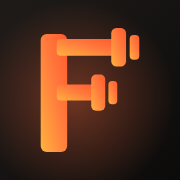
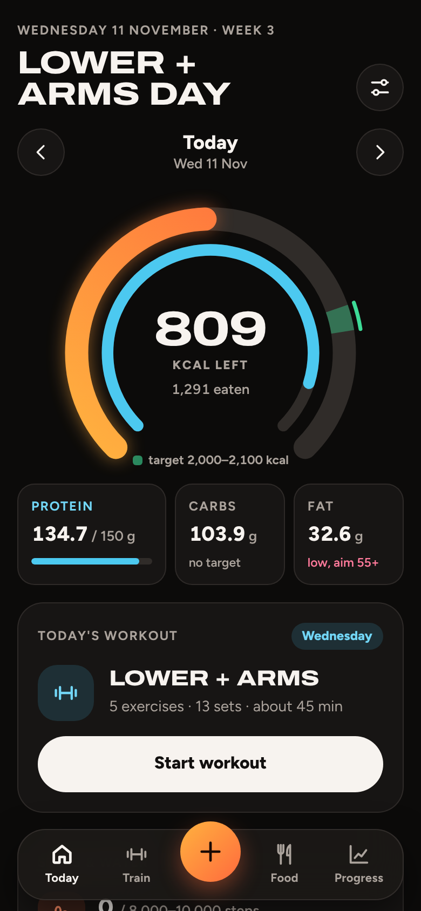
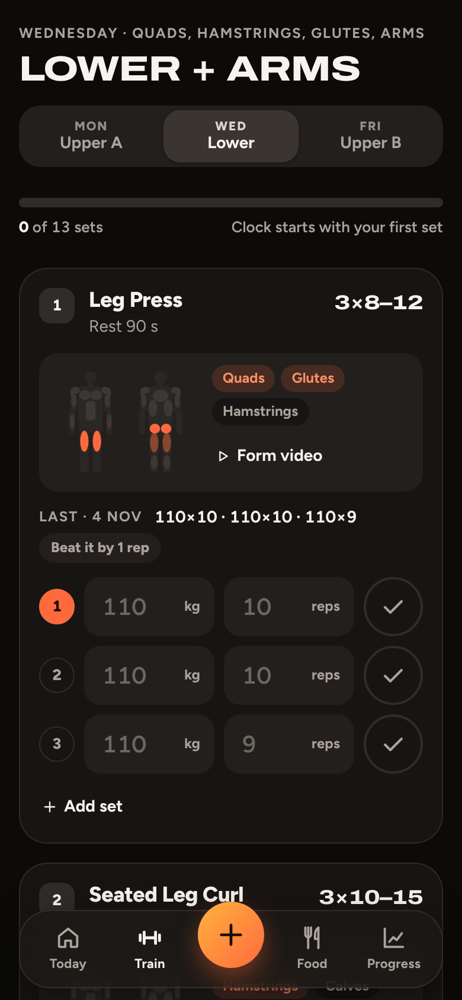
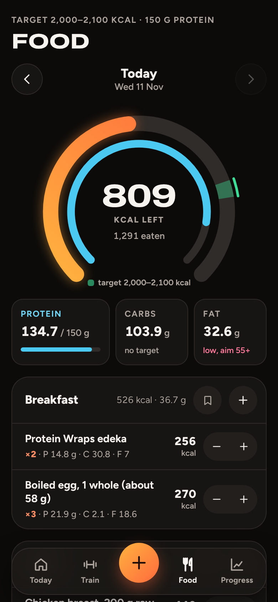
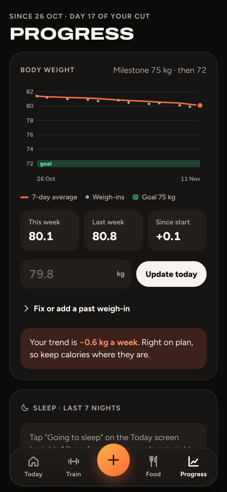

# Forge

A mobile-first training and nutrition tracker, built for one specific plan: three gym days a week while cutting fat and building muscle.

I was about to pay around $30 a month for two apps, one for workouts and one for food. Instead I built one app that does both and is shaped around exactly how I train and eat.

**Live demo:** https://sajedayad.github.io/Forge/ (open it on your phone and add it to your home screen: it opens full screen with its own icon, like a real app)

<p>
  
  
  
  
</p>

## Features

**Training**
- Upper / Lower / Upper split (Mon, Wed, Fri) with sets, rep ranges and supersets built in
- Logs weight and reps per set, shows what you did last time and tells you when to add weight
- Rest timer that starts on its own, with -15 s / +15 s
- Strength records: a "new record" alert when you beat your best set on any lift
- Workout score out of 100 and total duration when you finish

**Nutrition**
- Daily calorie ring with a target range, plus protein, carbs and fat
- Breakfast, lunch, dinner and snack, with duplicates merged into x2, x3
- Per portion or per 100 g entry, weight and amount
- Quick add from recent foods and saved meals (log a whole meal in one tap)
- End-of-day summary with a score and tips

**Recovery and progress**
- Sleep tracker: "Going to sleep" / "I'm awake", wake-up times based on 90-minute cycles, weekly insights
- Body weight trend (7-day average), waist tracking, steps and water
- Weekly check-in every Sunday that says whether to keep, lower or raise calories
- Day navigation to look back at, or fix, any previous day

**AI features** (only when opened inside Claude)
- Scan a nutrition label from a photo and read the exact values
- Identify a food from a photo, with values per 100 g raw and cooked
- Describe a meal in words and get a calorie and protein estimate
- Personal day and sleep reviews

Outside Claude the app works fully without these, and you enter numbers by hand.

## Tech

- Plain HTML, CSS and JavaScript. No framework, no build tools beyond a 10-line Python script.
- Mobile-first layout with a floating tab bar and bottom sheets, light and dark mode.
- Charts and progress rings drawn as inline SVG.
- Data is stored in the browser (`localStorage`), so it stays on your device. Inside Claude it uses Claude's artifact storage instead, so it syncs between devices.

```
src/
  head.html    page head (meta tags, fonts)
  app.css      all styles, built on colour and size tokens
  shell.html   static layout: tab bar, sheet, toasts
  app.js       state, views, actions and storage
build.py       joins src/ into index.html
index.html     the built app (this is what GitHub Pages serves)
```

## Run it

Open `index.html` in a browser. That's it.

To change something, edit the files in `src/`, then run:

```
python3 build.py
```

## How I built it

I built this together with Claude, Anthropic's AI. I decided what the app should do, designed the training and nutrition logic around my own plan, tested every feature on my phone and kept asking for changes until it worked the way I wanted. Claude wrote most of the code.

## Ideas for next

- Barcode scanning with an open food database
- Export data as CSV
- Make the training plan editable inside the app
